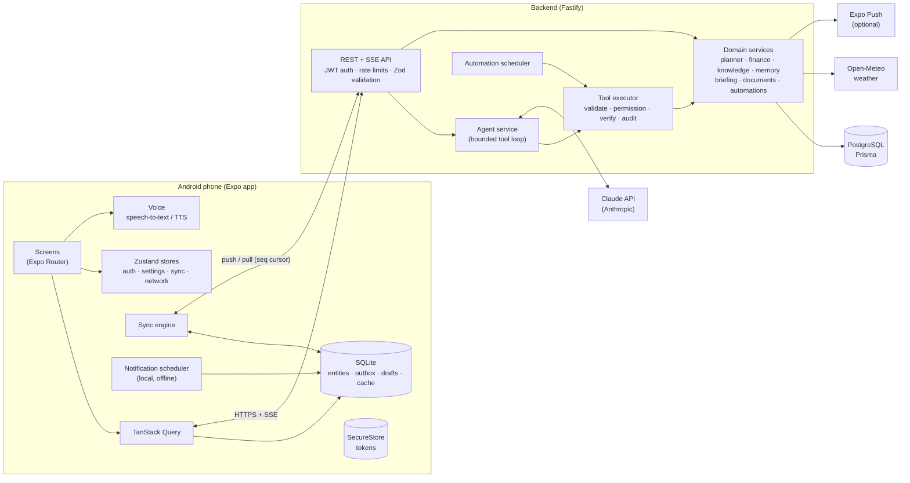
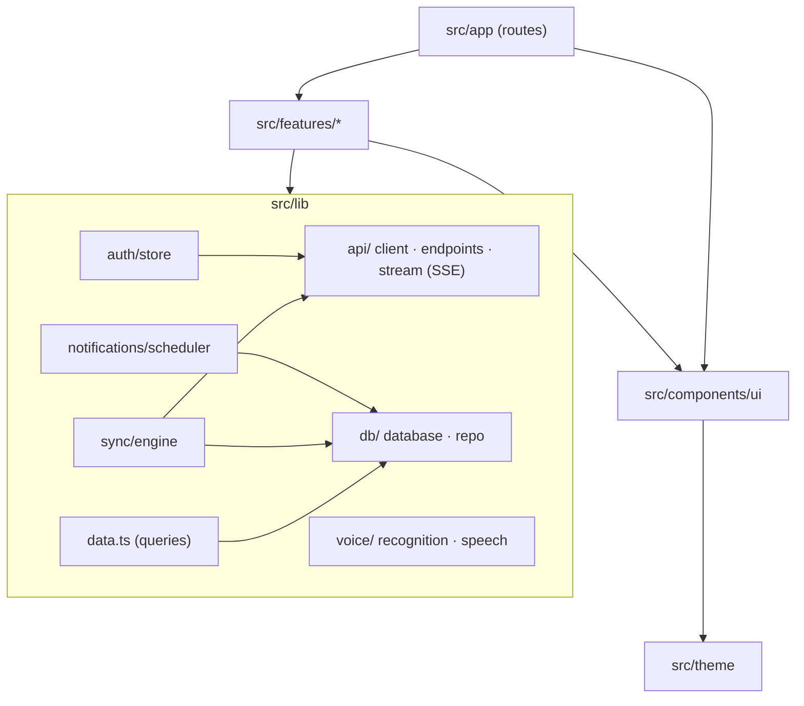
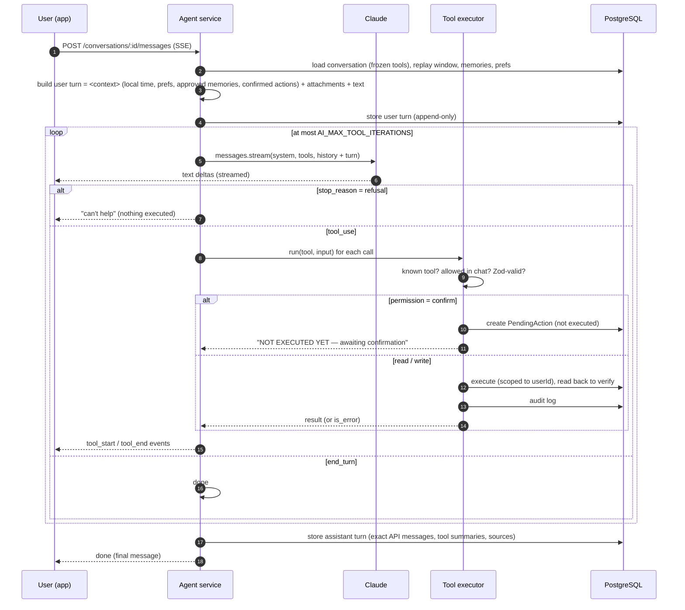
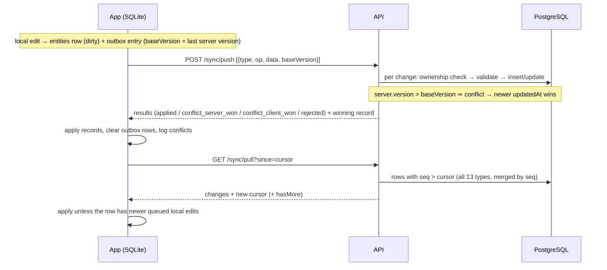

# Architecture

## System overview



### Key decisions

| Decision | Why |
|---|---|
| **Monorepo with `packages/shared`** | One Zod schema per entity, DTO and tool, used by the server, the client and the tests. |
| **Local-first SQLite + outbox** on the phone | Tasks, notes, habits, finance and the rest work fully offline; edits are instant and sync later. |
| **Generic entity sync** (13 types, one engine) | Every syncable table shares an envelope (`id`, `updatedAt`, `deletedAt`, `version`, `seq`). A Postgres trigger bumps `version` and assigns `seq` from a global sequence, and clients pull "everything after cursor *n*". |
| **Last-writer-wins per record** on `updatedAt` (client edit time) + `version` conflict detection | Simple, predictable merging. Conflicts are logged and shown in Settings → Sync. |
| **AI only on the server** | Keys never ship in the app. The server enforces tool permissions, rate limits and auditing. |
| **Typed tool catalog instead of free-form actions** | The model can only call declared tools with validated inputs; consequential tools need confirmation. |
| **Append-only conversation history** | A frozen system prompt and tool set per conversation, and exact replay of stored API messages. Keeps prompt caching effective and works with Claude's preserved-thinking checks. |
| **Embedded PostgreSQL for dev/tests** | No Docker or system install needed; tests run against real Postgres semantics. |

## Mobile module structure



## AI execution flow (one user message)



### Confirmation flow

```mermaid
sequenceDiagram
  participant U as User
  participant App
  participant API
  participant T as Tool executor
  participant D as DB
  App->>U: Confirmation card "Delete task “Old task”"
  U->>App: Confirm
  App->>API: POST /actions/:id/confirm
  API->>D: atomically claim (pending → confirmed); expired → 410, already decided → 409
  API->>T: run(tool, stored input, confirmed=true)
  T->>D: execute + verify + audit
  API->>D: append event message to the conversation
  API-->>App: real result (succeeded / failed)
  Note over API,D: On the next turn the model sees "User confirmed: …" in the context block
```

### Safety layers

1. **The system prompt**: honesty rules, data-vs-instructions handling for untrusted content, limits (can't send, call or pay).
2. **The tool catalog**: no shell, SQL, eval or generic HTTP. Every input is Zod-validated.
3. **Permission classes**: `confirm` tools (deletes, memory writes) become PendingActions that only an authenticated
   request from the user can execute. Automations cannot use them.
4. **Bounded loops**: a maximum number of iterations per turn. A `max_tokens` cut-off never executes partial tool input,
   and refusals execute nothing.
5. **Verification**: write tools read back the record before reporting success.
6. **Isolation**: every query is scoped to the authenticated `userId`, which tests verify.
7. **Untrusted content without tools**: document summaries, Q&A and translation calls have no tools at all.

## Sync protocol



Triggers: app launch, reconnect, foreground, every 2 minutes, and 1.5 s after any local edit.

## Notifications

Reminders, task alerts, event alerts, bill reminders and daily briefing nudges are **local
notifications** scheduled from the on-device database. They fire without connectivity. The scheduler
reconciles the next 14 days (≤ 60 notifications) whenever relevant data or preferences change.
Automation output is stored in the server inbox, and pushed through Expo when push is configured.

## Context management for long chats

When the replayed history exceeds roughly 600k characters, the agent summarizes the conversation (*simple
compaction*) and starts a new replay window whose first user turn carries the summary. Earlier turns stay
visible in the app but are no longer sent to the model.
