# Database schema

PostgreSQL via Prisma (`apps/backend/prisma/schema.prisma`). Migrations live in `apps/backend/prisma/migrations`
and are applied with `npm run db:migrate` (`prisma migrate deploy`).

```mermaid
erDiagram
  users ||--o{ refresh_tokens : has
  users ||--o{ conversations : owns
  conversations ||--o{ messages : contains
  users ||--o{ pending_actions : "must confirm"
  users ||--o{ tool_executions : "audit log"
  users ||--o{ memories : "approved facts"
  users ||--o{ documents : "knowledge base"
  users ||--o{ automations : defines
  automations ||--o{ automation_runs : history
  users ||--o{ inbox_notifications : receives
  users ||--o{ tasks : syncs
  users ||--o{ events : syncs
  users ||--o{ reminders : syncs
  users ||--o{ notes : syncs
  users ||--o{ projects : syncs
  users ||--o{ habits : syncs
  users ||--o{ habit_logs : syncs
  users ||--o{ wellness_entries : syncs
  users ||--o{ transactions : syncs
  users ||--o{ budgets : syncs
  users ||--o{ recurring_payments : syncs
  users ||--o{ goals : syncs
  users ||--o{ routines : syncs
  projects ||--o{ tasks : "projectId (soft)"
  habits ||--o{ habit_logs : "habitId (soft)"
```

All user-owned tables reference `users.id` with `ON DELETE CASCADE`, so deleting an account deletes every row.

## Identity

| Table | Notes |
|---|---|
| `users` | `email` (unique, null for guests), `passwordHash` (argon2id), `isGuest`, `preferences` (JSON validated by `preferencesSchema`), `pushToken` |
| `refresh_tokens` | only the **SHA-256 hash** of each opaque token; `revokedAt`, `replacedById` (rotation chain for reuse detection) |

## Assistant

| Table | Notes |
|---|---|
| `conversations` | `title`, `webSearch` (tool set frozen at creation), `replayFrom` (compaction point) |
| `messages` | `role` user/assistant/event, `text` (display), `apiMessages` (exact Claude API messages for append-only replay), `toolCalls`, `sources`, `status`, unique `(userId, clientMessageId)` for idempotency |
| `pending_actions` | confirmation-gated tool calls: `toolName`, `input`, `description`, `status` pending/confirmed/rejected/expired/failed, `expiresAt` (24 h) |
| `tool_executions` | audit: tool, status, summary, duration, chat or automation source (no raw inputs) |
| `memories` | user-approved facts (`source` user/assistant) |
| `documents` | file bytes (`bytea`), extracted `text`, AI `summary`, `status` |

## Automations & notifications

| Table | Notes |
|---|---|
| `automations` | `trigger` (JSON), `steps` (JSON, validated against the tool catalog), `enabled`, `maxRetries`, `nextRunAt` |
| `automation_runs` | `status`, `trigger` schedule/manual/retry, `attempt`, per-step results, `cancelRequested`, `notBefore` (retry backoff) |
| `inbox_notifications` | automation and briefing output |

## Syncable entities

Every table below has the same envelope:

| Column | Meaning |
|---|---|
| `id uuid` | generated on the device (or server), stable across devices |
| `userId` | owner |
| `createdAt`, `updatedAt` | `updatedAt` is the **client modification time**, used for last-writer-wins |
| `deletedAt` | tombstone (soft delete, propagated by sync) |
| `version int` | incremented by trigger on each update |
| `seq bigint` | assigned from the global `sync_seq` sequence on every insert/update; pull cursor |

| Table | Fields |
|---|---|
| `tasks` | title, notes, priority, status, dueAt, remindAt, recurrence, projectId, tags[], completedAt, estimateMinutes |
| `events` | title, startAt, endAt, allDay, location, notes, kind (event/appointment/birthday), recurrence, reminderMinutesBefore |
| `reminders` | title, remindAt, recurrence, done, notes |
| `notes` | title, content, tags[], pinned, kind (note/journal), mood |
| `projects` | name, description, color, deadline, status |
| `habits` / `habit_logs` | name, icon, color, frequency, target, unit, archived / habitId, date (YYYY-MM-DD), value |
| `wellness_entries` | metric (water/sleep/exercise/weight/mood/steps), value, unit, date, note |
| `transactions` | kind, amountMinor (**bigint minor units**), currency, category, note, occurredAt, recurringId |
| `budgets` | category, limitMinor, currency, period |
| `recurring_payments` | name, kind (bill/subscription), amountMinor, currency, category, frequency, nextDueAt, active, remindDaysBefore |
| `goals` | title, kind, targetValue, currentValue, unit, deadline, status |
| `routines` | name, timeOfDay, time (HH:mm), days int[], steps text[], active |

## Hand-written SQL (in `…_init/migration.sql`)

- `CREATE SEQUENCE sync_seq`, plus a `BEFORE UPDATE` trigger `aura_bump_sync()` on all 13 entity tables
  (`version = OLD.version + 1`, `seq = nextval('sync_seq')`).
- GIN full-text indexes using the `simple` configuration, which keeps Hindi and Hinglish words intact, on notes
  (title+content), documents (name+text+summary) and memories.

## Device database (SQLite, `aura.db`)

`entities(type, id, data JSON, updated_at, deleted, version, dirty)`, `outbox(seq, type, id, op, data,
base_version, attempts, last_error)`, `meta(key, value)` (sync cursor, owner user id), `sync_log`, `drafts`,
`cache` (last good copies of online-only data). All of it is wiped on sign-out or account switch.
